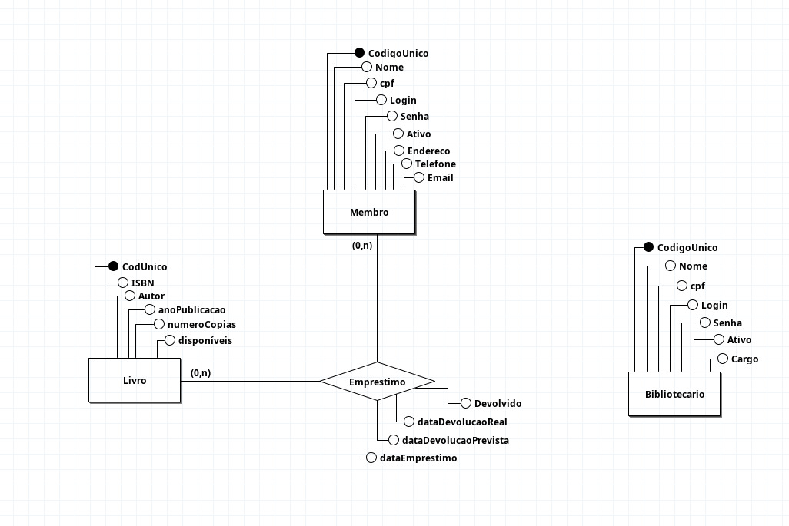
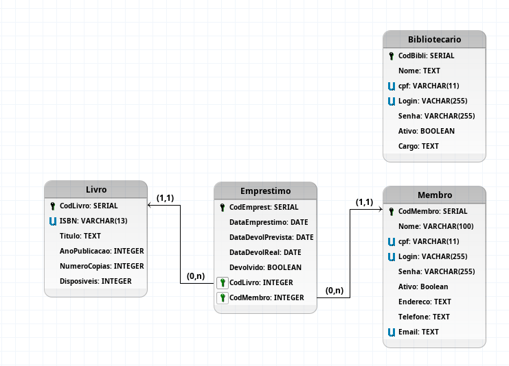

# Projeto-POO
Projeto para disciplina de POO. Construção de um sistema de gerênciamento de uma biblioteca.

## Banco de dados
### Conceitual

### Logico

## Tela de Login e Cadastro
### Login

### Cadastro 

